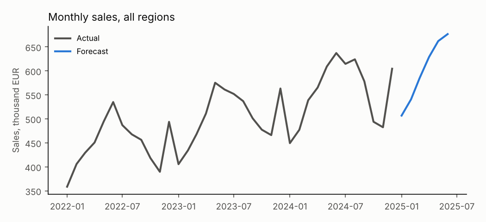

# Fundamentals of data analytics: three business cases

Linear algebra, statistics and anomaly detection on three small business problems: forecasting retail sales, finding what affects product quality, and flagging suspicious card transactions. I rebuilt this from my M.Sc. Data Analytics coursework (Fundamentals of Data Analytics, BSBI, 2024).

All three data sets are generated by the code, with effects I planted on purpose. That makes it possible to check each method against the right answer, which the original coursework data did not allow. The reasons are in [docs/coursework-review.md](docs/coursework-review.md).

```bash
pip install -e ".[dev]"
python -m fda        # writes data/ and reports/results.md in a few seconds
pytest               # 11 tests
```

Full output: [reports/results.md](reports/results.md).

## 1. Retail sales (linear algebra, regression)

Monthly sales for four regions over three years, with trend, seasonality, a December peak and marketing spend.

* **Same regression, three solvers.** Normal equations `(X'X)⁻¹X'y`, QR decomposition and least squares (SVD) agree to 7e-13. The condition number of X is 145, low enough that the normal equations are safe here. Above about 10⁶ they start to lose accuracy, and QR or SVD should be used.
* **SVD of the region x month matrix.** The first singular vector explains 92% of the variation: all regions follow one seasonal curve, at different levels.
* **Fit and forecast.** R² = 0.97. Trained on 30 months and tested on the last 6, the error is 4.6% (MAPE). The next six months come to about 3.6 million EUR.
* **Marketing effect: 1.8 per euro, against a planted 2.4.** Bigger regions spend more on marketing, so part of the marketing effect is absorbed by the region terms. A regression on data like this shows an association. It does not prove that extra spend causes extra sales.



## 2. Production quality (ANOVA, t-test, regression)

600 production batches with temperature, humidity, shift, production line and quality score. Planted effects: quality peaks at 21.5 °C, falls when humidity is above 50%, and is 2 points lower on night shift. The line has no effect.

Testing one factor at a time gets it wrong:

| Factor | ANOVA p-value | Effect size (η²) | Significant at 5% | After Bonferroni |
|---|---|---|---|---|
| Temperature band | 2e-109 | 0.58 | yes | yes |
| Humidity band | 0.030 | 0.015 | yes | no |
| Production line | 0.023 | 0.013 | **yes (false alarm)** | no |
| Shift | 0.57 | 0.001 | **no (missed)** | no |

The line looks significant by chance, and the night shift effect is hidden because temperature varies so much more. A single regression with all factors gets the planted effects back: night shift -2.05 (p < 1e-15), humidity -0.24 per point above 50%, best temperature 21.5 °C, and no line effect (p = 0.41 and 0.78).

What I would tell the plant: keep the hall at 21-22 °C, control humidity above 50%, and look at the night shift process. Changing lines will not help.

## 3. Card fraud (vectors, covariance, anomaly detection)

21,755 transactions on 300 cards over 90 days, 1% fraud (much larger amount than usual for that card, at night, in online, electronics or travel). Labels are kept in a separate file and used only to score the detectors.

Each transaction becomes a vector measured against its own card's history: amount relative to the card's median, night flag, hours since the previous transaction, and how rare the category is for that card. Three detectors flag the top 2% for review:

| Method | Precision | Recall | Average precision |
|---|---|---|---|
| Robust z-score of the amount (median and MAD per card) | 49% | 99% | 0.96 |
| Isolation Forest | 50% | 99.5% | 0.89 |
| Mahalanobis distance (covariance of the vectors) | 48% | 97% | 0.88 |

With 1% fraud and a 2% review queue, the best possible precision is 50%, so all three catch almost every planted case. The simplest method does best because the planted fraud is mostly about amount. Real fraud is harder to spot, and this setup is a starting point rather than a benchmark.

Card numbers are not part of the data. Each card has a key instead.

## Layout

```
src/fda/sales.py     Task 1: design matrix, three solvers, SVD, backtest, forecast
src/fda/quality.py   Task 2: ANOVA with effect size and Bonferroni, t-test, Tukey HSD, joint regression
src/fda/fraud.py     Task 3: card-relative features, robust z, Mahalanobis, Isolation Forest
src/fda/__main__.py  runs all three and writes the report
data/                generated data (fraud labels in a separate file)
reports/             results and chart
docs/                coursework review
```

## License

MIT
