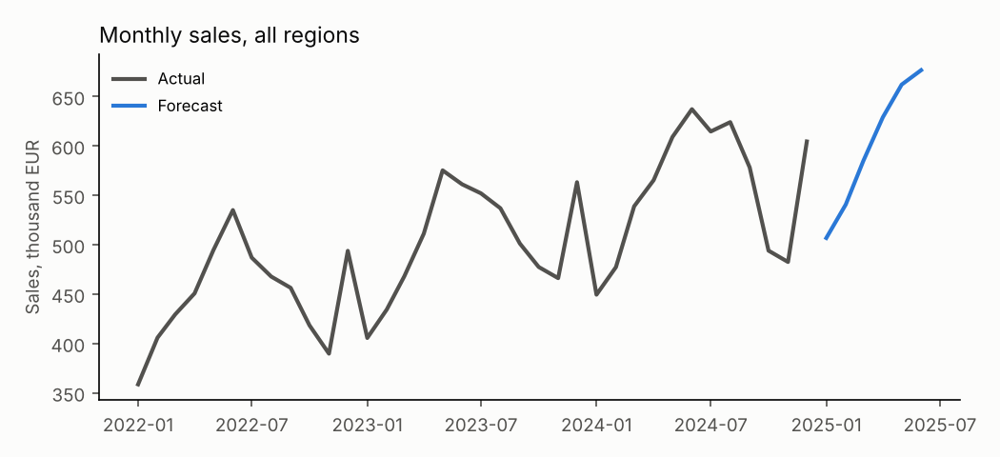

# Results

All data is generated by this repository (see `data/`). Numbers change only if the seeds change.

## Task 1: retail sales

Regression on 144 region-months. R² = 0.968. Condition number of X = 145.1.
Normal equations, QR and least squares agree to 7.1e-13.

| term | normal_equations | qr | lstsq |
|---|---|---|---|
| intercept | 132.033 | 132.033 | 132.033 |
| trend_per_month | 1.099 | 1.099 | 1.099 |
| marketing | 1.808 | 1.808 | 1.808 |
| season_sin | 0.271 | 0.271 | 0.271 |
| season_cos | -19.891 | -19.891 | -19.891 |
| december | 28.362 | 28.362 | 28.362 |
| region_South | -31.852 | -31.852 | -31.852 |
| region_East | -53.289 | -53.289 | -53.289 |
| region_West | -75.989 | -75.989 | -75.989 |

SVD of the region x month matrix: the first component explains 92% of the variation, so one seasonal curve is shared by all regions.
Backtest on the last 6 months: MAPE 4.6%.
Next six months: 3,599.6 thousand EUR; with 20% more marketing: 3,659.1.

## Task 2: production quality

| factor | groups | F | p_value | eta_squared | significant_at_5pct | significant_after_bonferroni |
|---|---|---|---|---|---|---|
| temperature_band | 5 | 202.21 | 2.12e-109 | 0.576 | True | True |
| humidity_band | 4 | 3.01 | 2.98e-02 | 0.015 | True | False |
| line | 3 | 3.81 | 2.26e-02 | 0.013 | True | False |
| shift | 2 | 0.33 | 5.68e-01 | 0.001 | False | False |

| temperature_band | mean | size |
|---|---|---|
| <18 | 59.89 | 105 |
| 18-20 | 77.27 | 147 |
| 20-23 | 82.24 | 208 |
| 23-25 | 77.49 | 92 |
| >25 | 60.17 | 48 |

Day vs night shift (Welch t-test): 74.84 vs 74.29, t = 0.59, p = 5.58e-01, Cohen's d = 0.05.
Regression with a temperature curve puts the best temperature at 21.5 °C.

All factors in one regression:

| term | estimate | std_error | t | p_value | significant_at_5pct |
|---|---|---|---|---|---|
| intercept | 84.544 | 0.268 | 315.98 | 0.00e+00 | True |
| temperature | 1.289 | 0.041 | 31.49 | 1.34e-128 | True |
| temperature_squared | -0.887 | 0.01 | -89.04 | 0.00e+00 | True |
| humidity_above_50 | -0.24 | 0.018 | -13.33 | 1.24e-35 | True |
| night_shift | -2.053 | 0.247 | -8.3 | 6.96e-16 | True |
| line_L2 | 0.083 | 0.292 | 0.29 | 7.75e-01 | False |
| line_L3 | 0.245 | 0.3 | 0.82 | 4.14e-01 | False |
| production_time | 0.055 | 0.024 | 2.27 | 2.33e-02 | True |

Tukey HSD, temperature bands:

| band_a | band_b | mean_diff | p_value |
|---|---|---|---|
| <18 | 18-20 | -17.38 | 0.0 |
| <18 | 20-23 | -22.35 | 0.0 |
| <18 | 23-25 | -17.6 | 0.0 |
| <18 | >25 | -0.28 | 0.9996 |
| 18-20 | 20-23 | -4.97 | 0.0 |
| 18-20 | 23-25 | -0.22 | 0.9995 |
| 18-20 | >25 | 17.1 | 0.0 |
| 20-23 | 23-25 | 4.75 | 0.0 |
| 20-23 | >25 | 22.07 | 0.0 |
| 23-25 | >25 | 17.32 | 0.0 |

## Task 3: card fraud

21,755 transactions, 1.0% fraud. Each method flags the top 2% for manual review.

| method | flagged | precision | recall | average_precision |
|---|---|---|---|---|
| robust_z | 436 | 0.491 | 0.986 | 0.956 |
| isolation_forest | 436 | 0.495 | 0.995 | 0.89 |
| mahalanobis | 436 | 0.484 | 0.972 | 0.878 |
